# Remaining Useful Life Prediction with Calibrated Uncertainty

**NASA C-MAPSS · LightGBM · Conformalized Quantile Regression · Reliability Engineering**

This project implements a Remaining Useful Life (RUL) prediction pipeline for aircraft turbofan engines using the NASA C-MAPSS datasets. It combines sensor-based regression, uncertainty estimation, and a reliability baseline to evaluate both prediction accuracy and maintenance decisions.

The pipeline uses LightGBM to estimate RUL and Conformalized Quantile Regression (CQR) to calibrate prediction intervals. A Weibull model fitted to fleet lifetimes serves as a baseline, and a maintenance simulation compares sensor-based predictions with age-based replacement policies.

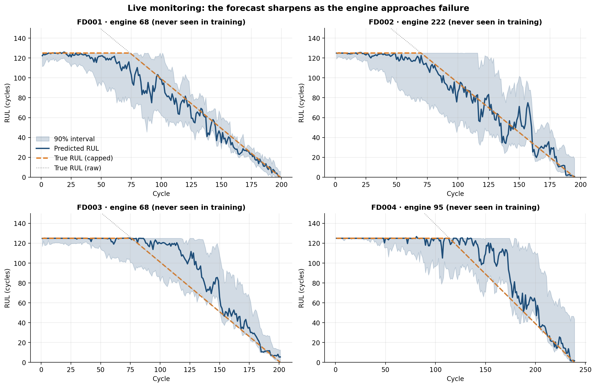

## Results

| Metric | FD001 | FD002 | FD003 | FD004 |
|---|---:|---:|---:|---:|
| Operating conditions / fault modes | 1 / 1 | 6 / 1 | 1 / 2 | 6 / 2 |
| Weibull model RMSE | 33.7 | 32.6 | 50.4 | 48.1 |
| Ridge regression RMSE | 16.0 | 15.7 | 16.7 | 19.8 |
| **LightGBM median RMSE** | **14.5** | **14.5** | **13.4** | **16.6** |
| Quantile regression coverage (nominal 90%) | 73% | 75% | 75% | 64% |
| **Coverage after conformal calibration** | **87%** | **92%** | **91%** | **89%** |

*RMSE is evaluated on the official test sets, comprising 707 engines in total, with RUL capped at 125 cycles. Coverage is evaluated on the holdout engines.*

The main results are:

- LightGBM achieves lower RMSE than both the Weibull baseline and Ridge regression on all four datasets.
- The uncalibrated quantile models produce intervals with empirical coverage below the nominal 90% level. Conformal calibration brings coverage closer to the target across the four datasets.
- In the maintenance simulation, a sensor-based policy with a 10-cycle lead time results in approximately 7–9 cycles of unused life per engine while keeping unplanned failures at or below 5%. The age-based policy wastes approximately 100 cycles under the same constraint.

## Pipeline

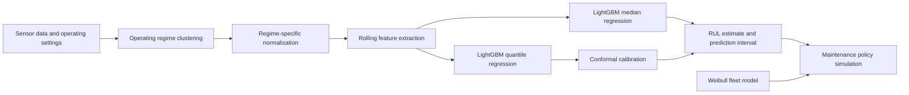

## Analysis

### 1. Sensor data and preprocessing

The C-MAPSS datasets contain run-to-failure trajectories for simulated turbofan engines. Each trajectory includes operating settings and measurements from 21 sensors.

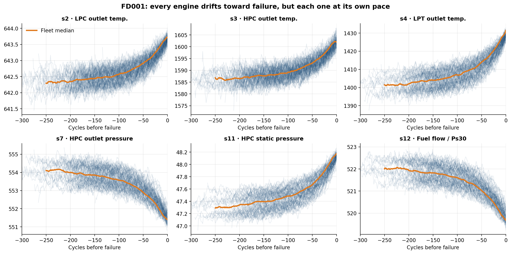

Sensor measurements vary in their usefulness for predicting degradation. Seven sensors are nearly constant in the training data, while the remaining fourteen are retained for feature extraction.

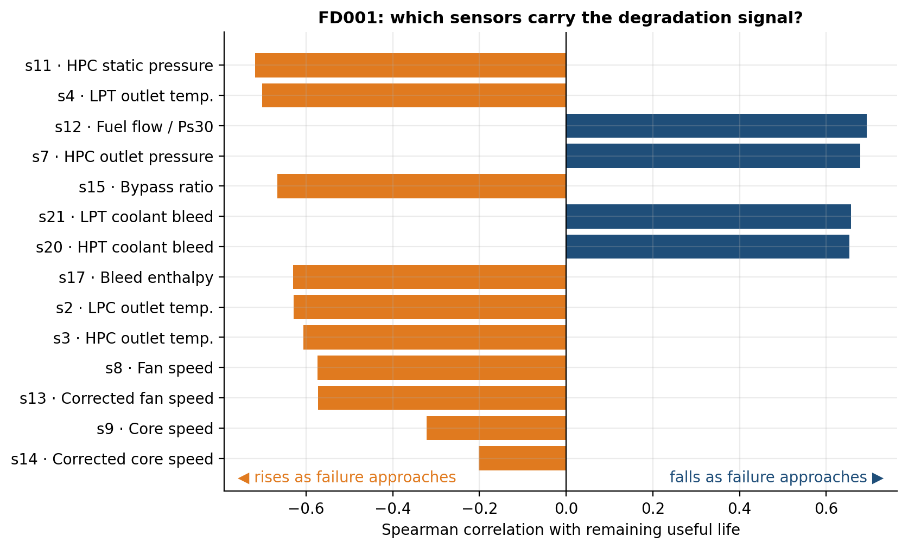

FD002 and FD004 contain six operating regimes. Differences between these regimes introduce variation in sensor readings that is not necessarily related to degradation. K-means clustering is used to identify operating regimes, followed by normalization within each regime.

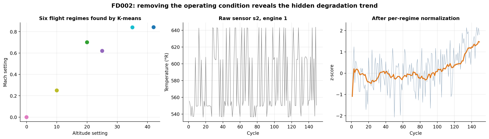

### 2. Weibull reliability baseline

A two-parameter Weibull distribution is fitted to the fleet lifetimes. Its shape parameter is greater than one, indicating an increasing failure rate with age.

The model estimates RUL from engine age using the mean residual life of the fitted distribution. Unlike the regression models, it does not use sensor measurements.

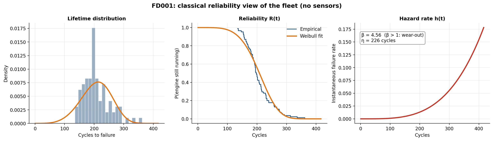

### 3. RUL predictions

LightGBM is used to predict the median RUL for each test engine. The evaluation compares predicted values with the corresponding targets.

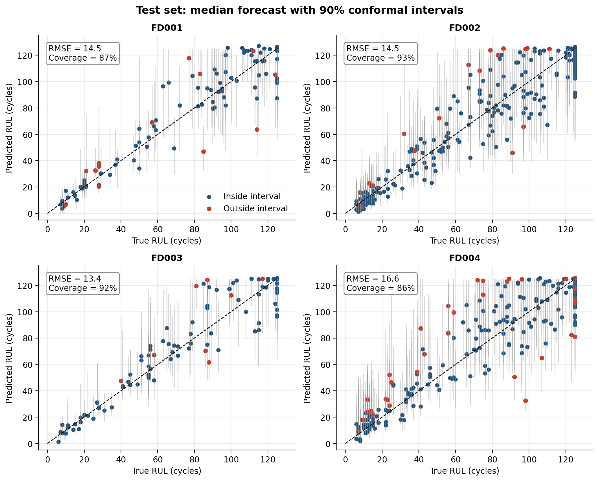

Prediction intervals are generated from lower- and upper-quantile models. Their widths vary across engines, reflecting differences in the uncertainty estimates.

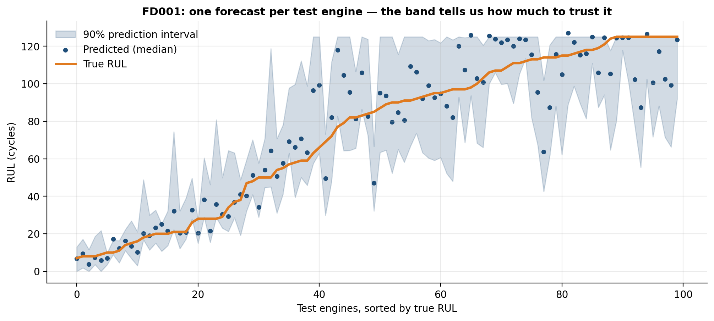

### 4. Conformal calibration

Quantile regression provides an initial estimate of the prediction interval, but its empirical coverage is below the nominal 90% level. Conformal calibration adjusts the interval bounds using residuals from held-out training engines.

The calibration procedure uses engine-grouped folds so that observations from the same engine do not appear in both the fitting and calibration subsets.

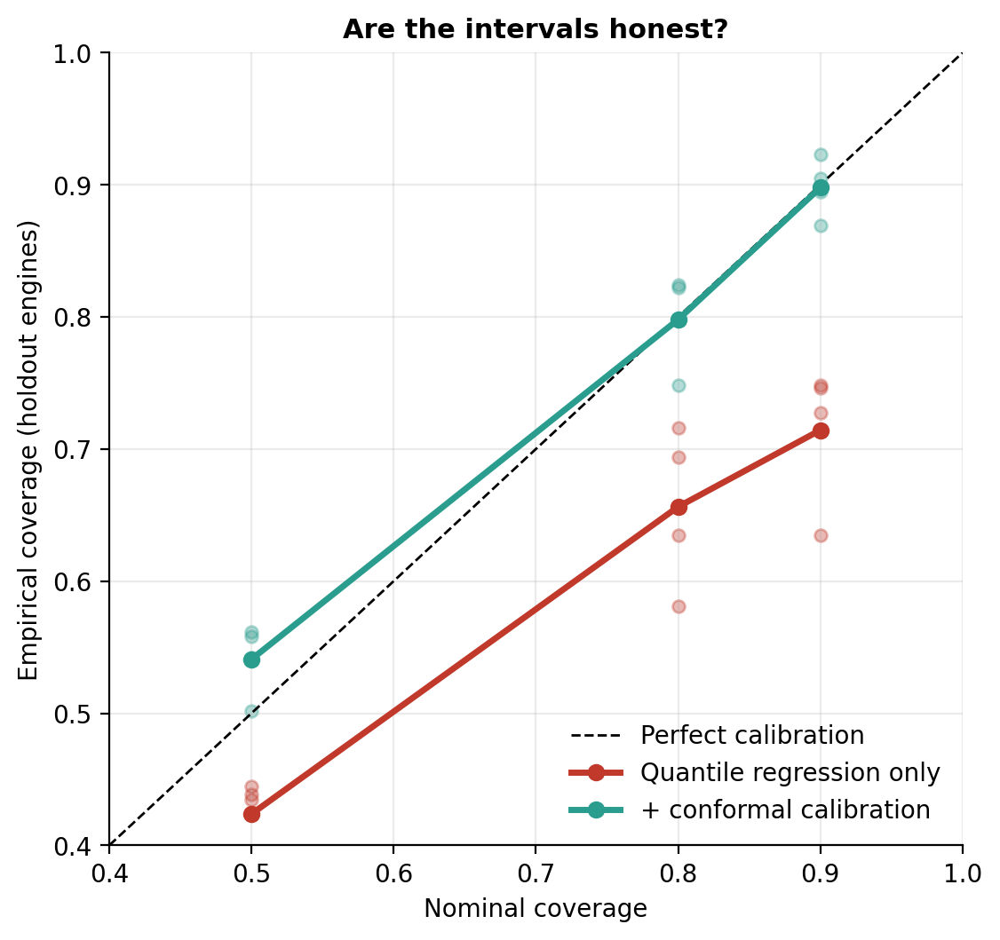

### 5. Prediction errors and feature importance

The error distribution provides additional information about model performance. In prognostics, overestimating RUL can be particularly costly because an engine may fail before maintenance is scheduled. The PHM08 score is included to account for the asymmetric cost of prediction errors.

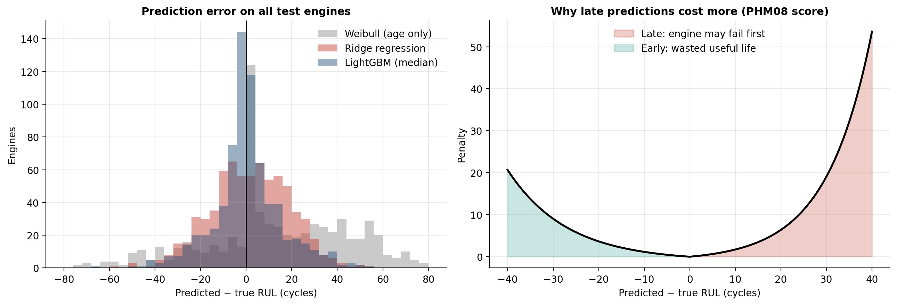

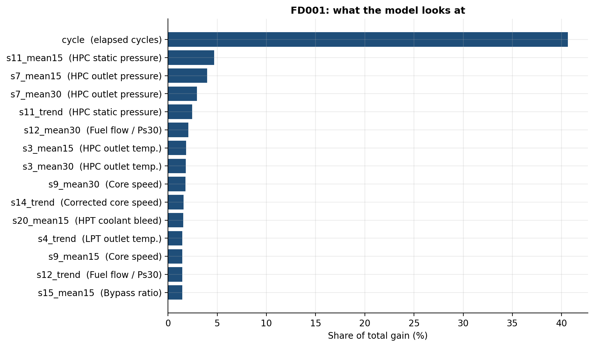

Elapsed cycle count is the strongest individual feature. However, age alone does not capture differences in degradation between engines. The sensor-based model improves on the age-only Weibull baseline, reducing RMSE from 33.7 to 14.5 on FD001.

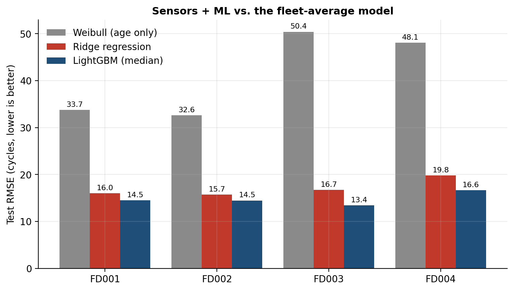

### 6. Maintenance policy evaluation

The final stage uses the predicted RUL to determine when maintenance should be performed. Each policy is evaluated over a range of thresholds, allowing the number of unplanned failures to be compared with the amount of useful life discarded through early replacement.

The simulation uses a 10-cycle maintenance lead time and evaluates the trade-off on 106 engines not used to fit the models.

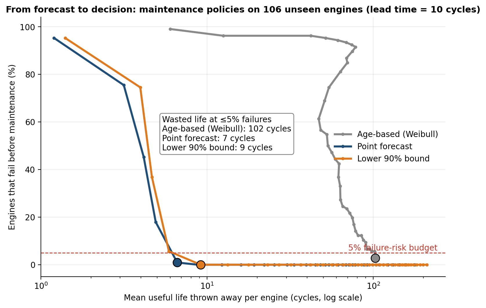

## Methodology

**Target variable.** RUL is capped at 125 cycles, following the piecewise-linear target convention commonly used with C-MAPSS. This prevents the model from being penalized for estimating exact lifetimes far from the degradation region.

**Feature extraction.** For each of the 14 selected sensors, rolling means over 5, 15, and 30 cycles are calculated, along with a short-minus-long rolling-mean trend and a rolling standard deviation. Elapsed cycle count is also included, giving 71 features per observation.

**Point prediction.** LightGBM is trained with quantile loss at \(q = 0.5\), producing the median RUL estimate.

**Uncertainty estimation.** Conformalized Quantile Regression (CQR), based on [Romano et al. (2019)](https://arxiv.org/abs/1905.03222), combines lower- and upper-quantile predictions with a correction estimated from held-out residuals. Five engine-grouped folds are used. Grouping by engine avoids splitting correlated observations from the same trajectory across fitting and calibration subsets.

**Quantile initialization.** Approximately 40% of the training targets are equal to the 125-cycle cap. With the default initialization, the upper-quantile models can remain at the cap and fail to learn useful differences between observations. Setting `boost_from_average=False` addresses this issue.

**Reliability baseline.** A two-parameter Weibull distribution is fitted to fleet lifetimes. Mean residual life is calculated using the regularized incomplete gamma function.

**Maintenance simulation.** Maintenance is triggered when the selected signal falls below a threshold. If the true RUL at that point is shorter than the 10-cycle lead time, the event is counted as an unplanned failure. Otherwise, the remaining life beyond the lead time is counted as unused life.

## Project structure

```text
├── config.py
├── run.py
├── scripts/
│   └── download_data.py
├── src/
│   ├── data.py
│   ├── features.py
│   ├── models.py
│   ├── reliability.py
│   ├── metrics.py
│   └── plots.py
├── tests/
│   └── test_core.py
├── figures/
└── results/
```

- `config.py`: configuration parameters.
- `run.py`: pipeline execution.
- `scripts/download_data.py`: downloads the C-MAPSS data.
- `src/data.py`: data loading, RUL labels, regime normalization, and engine splits.
- `src/features.py`: rolling feature extraction.
- `src/models.py`: LightGBM, Ridge regression, and conformal regression.
- `src/reliability.py`: Weibull model and maintenance simulation.
- `src/metrics.py`: prediction and calibration metrics.
- `src/plots.py`: figure generation.
- `tests/test_core.py`: unit tests.
- `figures/`: generated plots.
- `results/`: evaluation metrics and predictions.

## Installation and execution

Create a virtual environment and install the dependencies:

```bash
python -m venv .venv
```

```powershell
.venv\Scripts\Activate.ps1
```

Install the dependencies and run the pipeline:

```bash
pip install -r requirements.txt

python scripts/download_data.py
python run.py --quick
python run.py
pytest
```

The `--quick` option runs the pipeline on FD001 only. Without this option, all four datasets are processed.

## Limitations and future work

- Conformal coverage relies on assumptions about the relationship between calibration and future observations. Changes in fleet composition or operating conditions may require recalibration or adaptive methods.
- The reported test RMSE follows the official C-MAPSS evaluation protocol, using one prediction per test engine at its last observed cycle. Other analyses use complete engine trajectories.
- Possible extensions include sequence-based models such as CNNs, LSTMs, and Transformers; survival models with time-varying covariates; and maintenance thresholds optimized for fleet-specific costs.

## Data and references

A. Saxena, K. Goebel, D. Simon, and N. Eklund. “Damage Propagation Modeling for Aircraft Engine Run-to-Failure Simulation.” *International Conference on Prognostics and Health Management*, 2008.

Dataset: NASA Prognostics Center of Excellence Data Set Repository, C-MAPSS turbofan engine degradation simulation.

## Author

**Evelyn Natalie Aguiar de Almeida**

Mechanical Engineer · M.Sc. in Computer Science · Ph.D. Student in Computer Science
